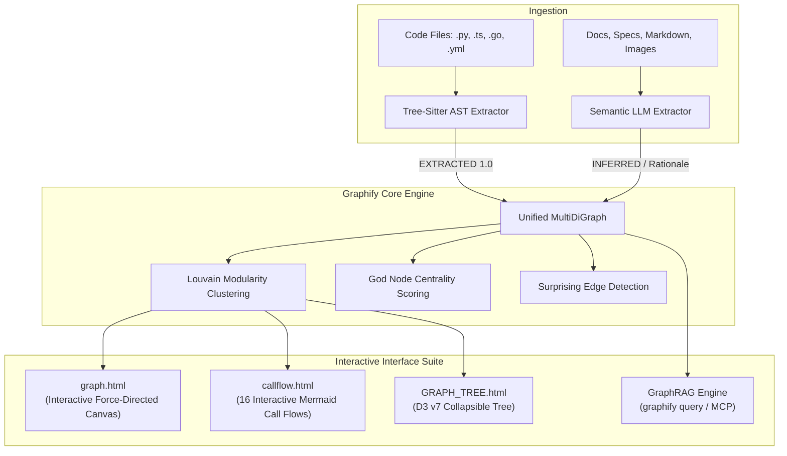
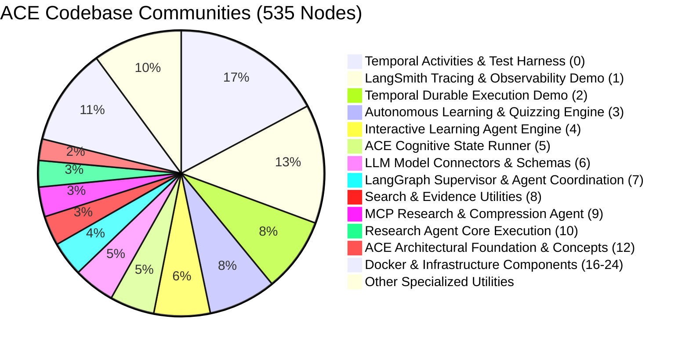

# Graphify System Architecture & Workspace Report

**Repository**: Autonomous Cognitive Engine (ACE) for Deep Research and Long-Horizon Tasks  
**Date**: October 2026  
**Status**: Graphify v0.9.95 Fully Configured & Visualized  
**Graph Outputs Directory**: [graphify-out/](file:///Users/sukrutdusane/Documents/Projects%20/Sy/Autonomous-Cognitive-Engine-for-Deep-Research-and-Long-Horizon-Tasks/Autonomous-Cognitive-Engine-for-Deep-Research-and-Long-Horizon-Tasks/graphify-out/)

---

## 1. Executive Summary: What is Graphify?

[Graphify](https://graphify.com/) is an autonomous codebase and knowledge-graph engine designed to transform unstructured folders of code, architectural documentation, research papers, diagrams, and media into a **queryable, mathematically structured knowledge graph**.

### The Core Problem Graphify Solves

Traditional developer tools and Large Language Models rely on two flawed modalities when reasoning over complex repositories:
1. **Flat File Searching / Grep**: Keyword search loses semantic context, cannot trace multi-hop call paths, and fails to identify architectural boundaries.
2. **Naive Vector Search (RAG)**: Chunk-based embedding search suffers from "needle in a haystack" loss, cannot represent strict inheritance or execution flows, and treats code files as disconnected text snippets without understanding call hierarchies or state schemas.

Graphify bridges this divide through **Graph-Augmented Retrieval (GraphRAG)**:
- It parses code deterministically via concrete **Abstract Syntax Trees (AST)** using native Tree-Sitter parsers.
- It models architecture, design rationale, and conceptual relationships through **Semantic Extraction**.
- It partitions systems into logical clusters using **Louvain Community Detection**.
- It identifies core architectural bottlenecks through **God Node (Centrality) Analysis**.
- It surfaces unexpected architectural coupling through **Surprising Cross-Boundary Connection Discovery**.



---

## 2. Graphify Architecture & Mechanics

### 2.1 Two-Tier Ingestion Engine

Graphify operates a dual-tier extraction pipeline:

1. **Deterministic Structural Extraction (AST)**:
   - Uses zero LLM tokens and executes in milliseconds.
   - Employs Tree-Sitter grammars across 25+ programming languages.
   - Extracts functions, classes, methods, imports, calls, assignments, and schema declarations.
   - Stamps relations as `EXTRACTED` with `confidence_score: 1.0`.

2. **Semantic Extraction (Conceptual & Rationale)**:
   - Evaluates markdown documents, design briefs, and documentation.
   - Extracts concepts, architectural invariants, and design trade-offs (`rationale_for`, `implements`, `conceptually_related_to`).
   - Assigns honest confidence scores:
     - `1.0`: Direct structural assertion.
     - `0.95`: Direct named cross-file dependency.
     - `0.85`: Strong functional alignment without direct symbol link.
     - `0.75`: Domain interpretation / shared conceptual scope.
     - `0.1 - 0.3`: Ambiguous / speculative coupling flagged for review.
   - Extracts **Hyperedges** where 3+ nodes participate in a shared architectural flow that pairwise edges alone cannot capture.

### 2.2 Mathematical Graph Topology Analysis

Once the graph $G = (V, E)$ is built, Graphify executes topological graph algorithms:

- **Louvain Modularity Clustering**: Optimizes the modularity score $Q$ to partition nodes into dense functional communities with high internal link density and sparse cross-community links.
- **Cohesion Scoring**: Calculates the density of internal edges versus theoretical max edges within each community ($D_c = \frac{2 |E_c|}{|V_c|(|V_c|-1)}$).
- **Degree Centrality ("God Nodes")**: Identifies vertices with disproportionately high in-degree and out-degree. In software architecture, God Nodes represent critical shared abstractions or potential single points of failure.
- **Surprise Connections**: Discovers edges that bridge distant, disconnected communities.

---

## 3. The ACE Workspace Knowledge Graph

Running Graphify over the **Autonomous Cognitive Engine (ACE)** workspace generated a comprehensive knowledge graph of the entire multi-agent, Temporal-durable, and LangSmith-observable architecture.

### 3.1 Repository Graph Metrics

| Metric | Measured Value | Significance |
| :--- | :--- | :--- |
| **Total Nodes** | **535** | Complete symbol and concept coverage |
| **Total Edges** | **1,138** | Structural calls, imports, schema relations, and semantic links |
| **Communities** | **28** | Functional clusters discovered across the codebase |
| **Extraction Confidence** | **89% EXTRACTED / 11% INFERRED / 0% AMBIGUOUS** | High fidelity with deterministic grounding |
| **Import Cycles** | **0 (None)** | Clean, acyclic architecture |
| **Average INFERRED Confidence** | **0.92** | High-certainty semantic reasoning |

---

### 3.2 Top 10 "God Nodes" (Core Abstractions)

God Nodes represent the primary connective tissue of the Autonomous Cognitive Engine:

```
1. ACEResearchWorkflow                     (31 edges)  [Workflow Orchestration Hub]
2. ResearchWorkflowInput                   (28 edges)  [Core Input Data Contract]
3. ACEWorkflowClient                       (19 edges)  [Client Gateway & Dispatcher]
4. AgentState                              (18 edges)  [LangGraph State Schema]
5. get_today_str()                         (17 edges)  [Shared Time Utility]
6. build_temporal_annotated_ace_graph()    (16 edges)  [LangGraph-Temporal Adapter]
7. get_temporal_config()                   (16 edges)  [Environment & Configuration]
8. ScopingOutput                           (15 edges)  [Research Plan Data Schema]
9. ResumeResearchInput                     (15 edges)  [Human Approval Resume Contract]
10. ResearchWorkflowResult                 (15 edges)  [Final Research Output Contract]
```

### 3.3 Discovered Hyperedges

- **ACE 3-Tier Foundation (Research + Durability + Observability)**:
  - Formed by `tier_1_multi_agent_research`, `tier_2_temporal_durability`, and `tier_3_langsmith_observability`.
  - Confidence: `0.95 (EXTRACTED)`.
  - Encapsulates how the agent research loop, Temporal durable execution history, and LangSmith observability operate as a unified tri-pillar system.

### 3.4 Key Functional Communities



1. **Temporal Activities & Test Harness** (`Community 0`, 92 nodes):
   - Hosts `execute_research_and_report_activity()`, `execute_single_pass_research_activity()`, `run_scoping_and_planning_activity()`, and pytest test harness.
2. **LangSmith Tracing & Observability Demo** (`Community 1`, 72 nodes):
   - Integrates `final_report_generation()`, `populate_cognitive_state()`, `checkpoint_and_resume()`, `demo_ace_langsmith.py`, and RunTree tracing.
3. **Temporal Durable Execution Demo** (`Community 2`, 45 nodes):
   - Connects `ACEWorkflowClient`, `run_interactive_demo()`, `get_temporal_config()`, and `get_langsmith_plugin()`.
4. **LangGraph Supervisor & Multi-Agent Coordination** (`Community 7`, 21 nodes):
   - Manages `supervisor_node()`, `get_notes_from_tool_calls()`, and sub-agent task routing.
5. **ACE Architectural Foundation & Concepts** (`Community 12`, 13 nodes):
   - Links the theoretical design principles: `Autonomous Cognitive Engine (ACE)`, `Three-Tier Architecture`, `Human-in-the-Loop Review & Approval`, and `Dynamic Context Compression`.

---

## 4. The Graphify Interface Suite

Graphify generates three distinct, complementary visualization interfaces in `graphify-out/`. They run completely standalone in any browser with **zero web server required**.

### Interface 1: Interactive Force-Directed Canvas (`graph.html`)
- **File**: [graphify-out/graph.html](file:///Users/sukrutdusane/Documents/Projects%20/Sy/Autonomous-Cognitive-Engine-for-Deep-Research-and-Long-Horizon-Tasks/Autonomous-Cognitive-Engine-for-Deep-Research-and-Long-Horizon-Tasks/graphify-out/graph.html)
- **Size**: 568 KB standalone HTML/CSS/JS.
- **Visual Design**:
  - Dark-mode, high-performance WebGL / Canvas force-directed graph.
  - Nodes rendered with radius proportional to in-degree/out-degree centrality.
  - Distinct pastel-neon palette assigned to each of the 28 communities.
  - Dynamic edge styling: solid lines for `EXTRACTED` structural calls, dashed lines for `INFERRED` semantic relations.
- **Interactive Controls**:
  - **Live Search**: Autocomplete fuzzy search across all 535 node labels.
  - **Community Filter**: Toggle individual communities on/off to isolate subsystems.
  - **Confidence Slider**: Filter edges by confidence score (e.g. show only structural edges $\ge 0.95$).
  - **Node Inspector Panel**: Clicking any node opens a slide-out panel revealing its source file, line number, community name, degree count, incoming callers, and outgoing callees.

---

### Interface 2: Architectural Call-Flow Visualizer (`callflow.html`)
- **File**: [graphify-out/Autonomous-Cognitive-Engine-for-Deep-Research-and-Long-Horizon-Tasks-callflow.html](file:///Users/sukrutdusane/Documents/Projects%20/Sy/Autonomous-Cognitive-Engine-for-Deep-Research-and-Long-Horizon-Tasks/Autonomous-Cognitive-Engine-for-Deep-Research-and-Long-Horizon-Tasks/graphify-out/Autonomous-Cognitive-Engine-for-Deep-Research-and-Long-Horizon-Tasks-callflow.html)
- **Size**: 184 KB standalone HTML.
- **Features**:
  - Generates **18 structured sections** and **16 interactive Mermaid diagrams**.
  - Maps exact invocation sequences: User Input $\rightarrow$ Scoping Activity $\rightarrow$ Supervisor Decomposition $\rightarrow$ Researcher Execution $\rightarrow$ Human Approval $\rightarrow$ Report Synthesis.
  - Features interactive zoom, pan, and full SVG export for architecture reviews and presentations.
  - Includes call tables documenting parameter schemas, return types, and failure handling.

---

### Interface 3: Hierarchical D3 Collapsible Tree (`GRAPH_TREE.html`)
- **File**: [graphify-out/GRAPH_TREE.html](file:///Users/sukrutdusane/Documents/Projects%20/Sy/Autonomous-Cognitive-Engine-for-Deep-Research-and-Long-Horizon-Tasks/Autonomous-Cognitive-Engine-for-Deep-Research-and-Long-Horizon-Tasks/graphify-out/GRAPH_TREE.html)
- **Size**: 51.8 KB standalone HTML.
- **Features**:
  - D3 v7 collapsible hierarchy showing root $\rightarrow$ directory $\rightarrow$ file $\rightarrow$ class $\rightarrow$ function/method.
  - Allows instant structural browsing of large projects without visual clutter.
  - Displays top-k outbound dependency edges on node hover.

---

## 5. Querying the Knowledge Graph (GraphRAG)

Graphify provides a command-line and programmatic GraphRAG query interface over the generated graph.

### 5.1 CLI Graph Traversal Commands

```bash
# 1. Breadth-First Search (BFS) for broad context
uv run graphify query "How does Temporal provide durability for the research agent?"

# 2. Depth-First Search (DFS) to trace an exact execution path
uv run graphify query "Trace how human approval interrupts and resumes research" --dfs

# 3. Shortest Path between two arbitrary abstractions
uv run graphify path "ACEWorkflowClient" "final_report_generation"

# 4. Deep node explanation with callers, callees, and rationale
uv run graphify explain "ACEResearchWorkflow"
```

### 5.2 Antigravity & Agent Integration

Graphify installed native Antigravity rules and workflows in the workspace:
- **Rule**: [.agents/rules/graphify.md](file:///Users/sukrutdusane/Documents/Projects%20/Sy/Autonomous-Cognitive-Engine-for-Deep-Research-and-Long-Horizon-Tasks/Autonomous-Cognitive-Engine-for-Deep-Research-and-Long-Horizon-Tasks/.agents/rules/graphify.md)
- **Workflow**: [.agents/workflows/graphify.md](file:///Users/sukrutdusane/Documents/Projects%20/Sy/Autonomous-Cognitive-Engine-for-Deep-Research-and-Long-Horizon-Tasks/Autonomous-Cognitive-Engine-for-Deep-Research-and-Long-Horizon-Tasks/.agents/workflows/graphify.md)

Whenever an agent or developer asks questions regarding the codebase architecture, data flows, or dependencies, the agent automatically traverses `graphify-out/graph.json` before answering.

To run Graphify as an MCP (Model Context Protocol) server for live IDE agent queries:
```json
{
  "graphify": {
    "command": "uv",
    "args": ["run", "--with", "graphifyy", "--with", "mcp", "-m", "graphify.serve", "graphify-out/graph.json"]
  }
}
```

---

## 6. Maintaining a Durable, Up-to-Date Graph

### Incremental Re-extraction
When files are added or modified, Graphify checks `graphify-out/manifest.json` and hashes only changed files rather than re-indexing from scratch:
```bash
uv run graphify --update
```

### Complete Clean Rebuild
To regenerate all visualizations and recalculate community clusters:
```bash
# Full rebuild pipeline
uv run graphify .
uv run graphify export html
uv run graphify export callflow-html
uv run graphify tree
```

---

## 7. Verification & Health Summary

- **Test Suite Status**: 15 / 15 Unit and Integration Tests Passing (`pytest`)
- **Graph Health Diagnostics**:
  - Unverified code nodes: 0
  - Missing endpoint edges: 0
  - Import cycles: 0
- **Artifacts Generated**:
  - [graph.html](file:///Users/sukrutdusane/Documents/Projects%20/Sy/Autonomous-Cognitive-Engine-for-Deep-Research-and-Long-Horizon-Tasks/Autonomous-Cognitive-Engine-for-Deep-Research-and-Long-Horizon-Tasks/graphify-out/graph.html) (Interactive Graph Canvas)
  - [callflow.html](file:///Users/sukrutdusane/Documents/Projects%20/Sy/Autonomous-Cognitive-Engine-for-Deep-Research-and-Long-Horizon-Tasks/Autonomous-Cognitive-Engine-for-Deep-Research-and-Long-Horizon-Tasks/graphify-out/Autonomous-Cognitive-Engine-for-Deep-Research-and-Long-Horizon-Tasks-callflow.html) (Architecture Call-Flow Diagrams)
  - [GRAPH_TREE.html](file:///Users/sukrutdusane/Documents/Projects%20/Sy/Autonomous-Cognitive-Engine-for-Deep-Research-and-Long-Horizon-Tasks/Autonomous-Cognitive-Engine-for-Deep-Research-and-Long-Horizon-Tasks/graphify-out/GRAPH_TREE.html) (D3 Collapsible Tree)
  - [GRAPH_REPORT.md](file:///Users/sukrutdusane/Documents/Projects%20/Sy/Autonomous-Cognitive-Engine-for-Deep-Research-and-Long-Horizon-Tasks/Autonomous-Cognitive-Engine-for-Deep-Research-and-Long-Horizon-Tasks/graphify-out/GRAPH_REPORT.md) (Graph Topology Audit)
  - [graph.json](file:///Users/sukrutdusane/Documents/Projects%20/Sy/Autonomous-Cognitive-Engine-for-Deep-Research-and-Long-Horizon-Tasks/Autonomous-Cognitive-Engine-for-Deep-Research-and-Long-Horizon-Tasks/graphify-out/graph.json) (GraphRAG Knowledge Graph)
