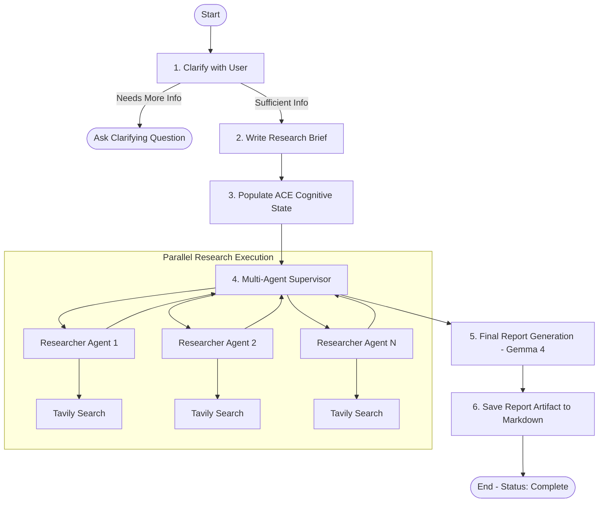
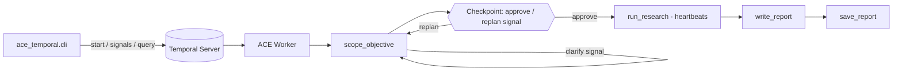

# Autonomous Cognitive Engine (ACE) for Deep Research and Long-Horizon Tasks

An open-source cognitive runtime and multi-agent deep research engine powered by **Google Gemma 4** (`gemma-4-26b-a4b-it`) served via **Jarvislabs Token Factory**, **LangGraph**, and **LangSmith**.

ACE equips autonomous AI agents with **persistent cognitive state** and **multi-agent research orchestration** for complex, long-horizon research objectives.

---

## Key Features

- **Persistent Cognitive State Architecture**: Explicit, checkpointable cognitive memory tracking:
  - `objective`: The original user intent preserved across multi-turn reasoning
  - `research_plan`: Living structured plan produced after scoping
  - `tasks`, `completed_tasks`, `pending_tasks`: Dynamic task lifecycle tracking
  - `sources`: Discovered URLs and verified citations
  - `decisions`: Key architectural and analytical decisions made during execution
  - `unresolved_questions`: Explicit tracking of open knowledge gaps
  - `status`: Lifecycle state (`researching`, `complete`)

- **Open-Weight Cognitive Intelligence (Gemma 4 on Jarvislabs)**:
  - Every agent step (scoping, supervision, research, compression, report) runs on **Gemma 4** (`gemma-4-26b-a4b-it`) via the OpenAI-compatible **Jarvislabs Token Factory** endpoint.
  - Switch providers with `RESEARCH_MODEL_PROVIDER` (`jarvislabs` | `gemma` for Google GenAI | `groq`); a provider without a valid key falls back to one that has one.
  - Structured output uses strict `json_schema` with automatic `function_calling` fallback, tuned from live measurements on the endpoint.
  - Built-in thinking token parsing (`extract_text_content`) preserving core reasoning outputs.

- **Hierarchical Multi-Agent Supervisor Pattern**:
  - Lead researcher agent dynamically orchestrates parallel sub-agents.
  - Isolated context windows per research sub-topic to prevent context bloat.
  - Tavily web search integration with iterative summarization and compression.

- **Full Observability & LangSmith Tracing**:
  - Native integration with LangGraph Studio for real-time visual orchestration.
  - End-to-end tracing in LangSmith tracking token usage, tool calls, and state diffs.

---

## Architecture Overview



---

## Quickstart

### Prerequisites

- **Python 3.11+** installed
- **uv** (recommended fast package manager):
  ```powershell
  # Windows PowerShell
  powershell -c "irm https://astral.sh/uv/install.ps1 | iex"
  
  # macOS / Linux
  curl -LsSf https://astral.sh/uv/install.sh | sh
  ```

---

### 1. Installation

Clone the repository and install dependencies:

```bash
git clone https://github.com/<your-username>/<your-repo-name>.git
cd "Autonomous Cognitive Engine for Deep Research and Long Horizon Tasks"
uv sync
```

Activate the virtual environment:
```powershell
# Windows PowerShell
.venv\Scripts\activate

# macOS / Linux
source .venv/bin/activate
```

---

### 2. Environment Configuration

Copy `.env.example` to `.env`:

```bash
cp .env.example .env
```

Fill in your API credentials:

```env
# Model provider for all agent steps: jarvislabs (default) | gemma | groq
RESEARCH_MODEL_PROVIDER=jarvislabs

# Primary Model: Gemma 4 via Jarvislabs Token Factory (OpenAI-compatible)
JARVISLABS_API_KEY=your_jarvislabs_api_key_here
JARVISLABS_MODEL=gemma-4-26b-a4b-it

# Alternative: Gemma 4 via Google GenAI (RESEARCH_MODEL_PROVIDER=gemma)
GOOGLE_API_KEY=your_google_api_key_here
GEMMA_MODEL_NAME=gemma-4-26b-a4b-it

# Optional fallback model: Groq
GROQ_API_KEY=your_groq_api_key_here
GROQ_MODEL=groq:qwen/qwen3.8-27b

# Web Search Tool: Tavily
TAVILY_API_KEY=your_tavily_api_key_here

# LangSmith Tracing & Observability (Optional)
LANGCHAIN_TRACING_V2=true
LANGCHAIN_API_KEY=your_langsmith_api_key_here
LANGCHAIN_PROJECT=deep_research_from_scratch
```

---

### 3. Launching LangGraph Studio (Interactive UI)

On Windows, use the helper launcher script:

```powershell
.\start_studio.ps1
```

Or start the server directly using uvx:

```powershell
$env:PYTHONIOENCODING="utf-8"
$env:PYTHONUTF8="1"
uvx --refresh --from "langgraph-cli[inmem]" --with-editable . --python 3.11 langgraph dev --port 8000 --allow-blocking
```

Open LangGraph Studio in your browser:
```
https://smith.langchain.com/studio/?baseUrl=http://localhost:8000
```

1. Select the `research_agent_full` graph.
2. Click **`+` (New Thread)**.
3. Submit your research topic.
4. Watch the agent clarify scope, generate the cognitive plan, run the research sub-agents, and write the final report.

---

### 4. Running Standalone Demo Scripts

#### A. Headless Automated Demo
Runs a complete multi-turn scoping loop and prints the structured ACE cognitive state snapshot:
```powershell
python demo_ace_run.py
```

#### B. Interactive LangSmith Live Demo
Designed for live presentations and hackathon demonstrations with direct LangSmith trace links:
```powershell
python demo_ace_langsmith.py
```

---

### 5. Running with Docker

You can also run the complete stack inside Docker:

```bash
# Build the image
docker-compose build

# Start the container in detached mode
docker-compose up -d

# View live logs
docker-compose logs -f

# Stop the container
docker-compose down
```

Access services:
- **LangGraph Studio**: `https://smith.langchain.com/studio/?baseUrl=http://localhost:8000`
- **REST API Docs**: `http://localhost:8000/docs`

---

### 6. Durable Execution with Temporal

ACE research runs can take many minutes and dozens of LLM / search calls. The `ace_temporal/` package runs the pipeline as a **Temporal workflow** so a run survives worker crashes, waits durably for human approval, and exposes its cognitive state live.



| Temporal feature | What it gives ACE |
|---|---|
| Activities per phase | Each phase is checkpointed; a crash only re-runs the phase in flight |
| Retry policy (exponential backoff) | Automatic recovery from LLM rate limits and transient failures |
| Heartbeats (5s, 20s timeout) | A killed worker is detected fast and research is retried on a live worker |
| Signals `clarify` / `approve` / `replan` | Durable human-in-the-loop: the run can wait hours or days at the checkpoint |
| Query `cognitive_state` | Live ACE cognitive state (status, plan, tasks, decisions) without touching the run |

**Run locally:**

```bash
# Terminal 1: Temporal dev server (Web UI at http://localhost:8233)
temporal server start-dev --db-filename temporal.db

# Terminal 2: worker
uv run python -m ace_temporal.worker

# Terminal 3: drive a research run
uv run python -m ace_temporal.cli start "Research durable execution patterns for AI agents" --id ace-demo
uv run python -m ace_temporal.cli status  ace-demo          # live cognitive state
uv run python -m ace_temporal.cli clarify ace-demo "Focus on open-source runtimes"   # if asked
uv run python -m ace_temporal.cli approve ace-demo          # or: replan ace-demo "new objective"
uv run python -m ace_temporal.cli result  ace-demo
```

Or with Docker: `docker-compose up -d temporal ace-worker`, then use the CLI from the host.

**Crash-recovery demo:** while status is `researching`, kill the worker (Ctrl+C) and start it again. The Temporal UI shows the heartbeat timeout and the `run_research` retry; scoping and the approval are **not** repeated.

Test the workflow logic without API keys: `uv run python test_temporal_workflow.py`

---

## Project Structure

```
├── .env.example                     # Environment variables template
├── .gitignore                       # Git ignore rules (protects credentials and runs)
├── Dockerfile                       # Container definition with Python 3.11 & uv
├── docker-compose.yml               # Multi-container orchestration
├── langgraph.json                   # LangGraph Studio graph manifests
├── pyproject.toml                   # Project dependencies and packaging
├── start_studio.ps1                 # Windows UTF-8 launcher script for Studio
├── demo_ace_run.py                  # Standalone ACE demonstration script
├── demo_ace_langsmith.py            # Interactive demo with LangSmith traces
├── test_ace_checkpoint.py           # Unit tests for ACE cognitive state persistence
├── notebooks/                       # Educational development notebooks
│   ├── 1_scoping.ipynb              # Scoping & clarification
│   ├── 2_research_agent.ipynb       # Single research agent + tools
│   ├── 3_research_agent_mcp.ipynb   # MCP (Model Context Protocol) integration
│   ├── 4_research_supervisor.ipynb  # Multi-agent supervisor pattern
│   ├── 5_full_agent.ipynb           # End-to-end full system
│   └── 6_checkpoint_agent.ipynb     # Checkpoint and interrupt deep-dive
└── src/
    └── deep_research_from_scratch/
        ├── gemma_model.py           # Gemma 4 initialization & thinking token parser
        ├── generate_checkpoint.py   # Snapshot extraction and cognitive logging
        ├── multi_agent_supervisor.py# Parallel research supervisor subgraph
        ├── prompts.py               # Prompt templates across all phases
        ├── research_agent.py        # Sub-agent search and compression loop
        ├── research_agent_full.py   # Full ACE production graph
        ├── research_agent_scope.py  # User clarification & research brief generation
        ├── state_scope.py           # AgentState definition with ACE cognitive fields
        └── utils.py                 # Markdown formatters and helper tools
```

---

## Testing

The `tests/` pytest suite has two tiers:

```powershell
# Offline: fake models and search, no API keys, no cost
python -m pytest -v

# Live: real Jarvislabs + Tavily calls (spends a few cents); needs keys in .env
python -m pytest --live -v tests/test_jarvislabs_endpoint.py   # endpoint, tool calling, structured output
python -m pytest --live -v -s                                  # everything, including a full end-to-end run
```

| File | Covers |
|---|---|
| `test_model_provider.py` | Provider selection, key fallback, Jarvislabs config, structured-output fallback chain |
| `test_jarvislabs_endpoint.py` | Live endpoint: models list, completions, tool calling, structured output |
| `test_web_search.py` | Tavily tool, dedup, summarization and its fallback |
| `test_research_agent.py` | Researcher loop: search -> reflect -> compress |
| `test_supervisor.py` | Delegation, parallel research, retries, completion guards |
| `test_full_flow.py` | Full graph: scoping -> research -> report saved |
| `test_live_e2e.py` | Live full run on Jarvislabs |

---

## AI Contribution & What Our Team Built

To help external evaluators, judges, and open-source contributors understand the technical contributions of our project:

### 1. What Our Team Built (The Core Innovation)
- **ACE Runtime & Cognitive State Schema (`src/deep_research_from_scratch/state_scope.py`)**:
  We designed an explicit, checkpointable cognitive state model that captures the agent's long-horizon mental model (`objective`, `research_plan`, `tasks`, `completed_tasks`, `pending_tasks`, `sources`, `decisions`, `unresolved_questions`, `status`). Unlike standard stateless agents, ACE makes cognitive trajectory transparent and inspectable.
- **Cognitive Snapshot & Inspection Utilities (`src/deep_research_from_scratch/generate_checkpoint.py`)**:
  Created utilities to extract, format, and log persistent state snapshots across threads and LangSmith tracing runs.
- **Production Graph & Multi-Provider Model Layer (`src/deep_research_from_scratch/gemma_model.py`)**:
  A single model factory routes every agent step to Jarvislabs Token Factory (default), Google GenAI, or Groq, with key-aware fallback and a structured-output fallback chain.

### 2. AI Model Roles
- **Google Gemma 4 (`gemma-4-26b-a4b-it`) on Jarvislabs Token Factory**: Primary cognitive model for scoping, deep reasoning, lead supervision, research compression, and final report generation.
- **Google GenAI / Groq**: Alternative providers selectable via `RESEARCH_MODEL_PROVIDER`.
- **Tavily Search**: Real-time web retrieval powering parallel researcher sub-agents.

---

## Demonstration Guide for Evaluators & Judges

When presenting or demonstrating this project to hosts, judges, or evaluators:

### Quick 2-Minute Demo Flow

1. **Start the Engine**:
   ```powershell
   python demo_ace_run.py
   ```
2. **Explain the Live Execution**:
   - **Phase 1 (Scoping)**: The agent analyzes the user prompt and determines if clarification is needed.
   - **Phase 2 (Cognitive Planning)**: The agent formulates a living research plan and populates all 9 ACE cognitive state fields.
   - **Phase 3 (Research)**: The supervisor delegates sub-topics to researcher agents, which search with Tavily and compress their findings.
   - **Phase 4 (Report)**: The final report is written and saved; point out the printed **ACE Cognitive State** table showing `objective`, `research_plan`, `decisions`, and `status: complete`.
3. **Show LangSmith Tracing**:
   - Open LangSmith to show the full visual execution trace under the project `deep_research_from_scratch`.

---

## License

This project is licensed under the **MIT License** — an OSI-approved open-source license. See the [LICENSE](LICENSE) file for the full license text.
