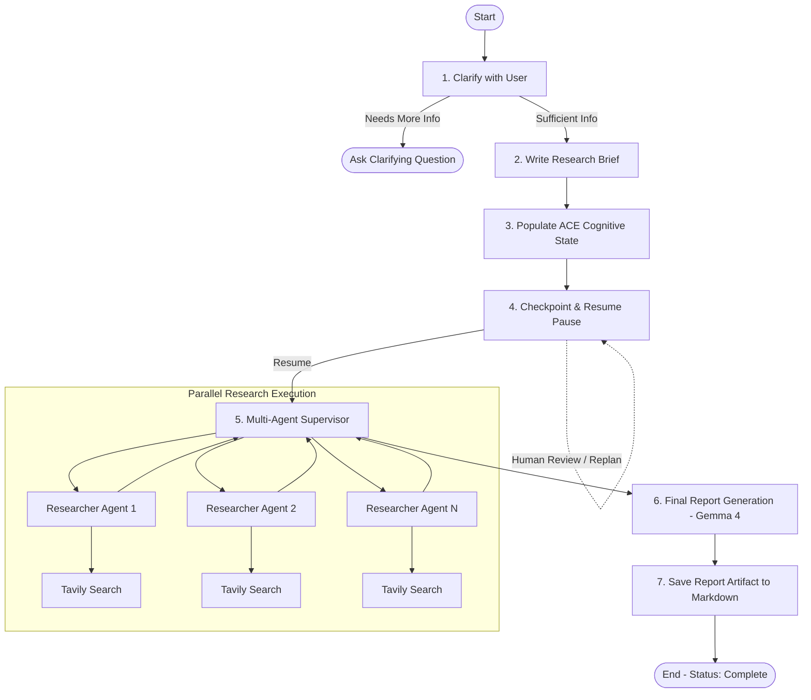

# Autonomous Cognitive Engine (ACE) for Deep Research and Long-Horizon Tasks

An open-source cognitive runtime and multi-agent deep research engine powered by **Google Gemma 4** (`gemma-4-26b-a4b-it`), **LangGraph**, and **LangSmith**.

ACE equips autonomous AI agents with **persistent cognitive state**, **human-in-the-loop checkpoint/resume**, and **dynamic replanning** capabilities for complex, long-horizon research objectives.

---

## Key Features

- **Persistent Cognitive State Architecture**: Explicit, checkpointable cognitive memory tracking:
  - `objective`: The original user intent preserved across multi-turn reasoning
  - `research_plan`: Living structured plan produced after scoping
  - `tasks`, `completed_tasks`, `pending_tasks`: Dynamic task lifecycle tracking
  - `sources`: Discovered URLs and verified citations
  - `decisions`: Key architectural and analytical decisions made during execution
  - `unresolved_questions`: Explicit tracking of open knowledge gaps
  - `status`: Lifecycle state (`planning`, `paused`, `researching`, `complete`)

- **Open-Weight Cognitive Intelligence (Gemma 4)**:
  - Primary reasoning powered by Google's **Gemma 4** (`gemma-4-26b-a4b-it`) via `ChatGoogleGenerativeAI`.
  - Built-in thinking token parsing (`extract_text_content`) preserving core reasoning outputs.
  - Sub-second scoping powered by Groq (`qwen/qwen3.8-27b`) for ultra-responsive user clarification.

- **Human-in-the-Loop Checkpoint & Dynamic Replanning**:
  - The graph pauses at `checkpoint_and_resume` via LangGraph `interrupt()`.
  - Inspect the full cognitive state snapshot before research begins.
  - Resume with `Command(resume=True)` or override direction with `Command(resume={"replan": "new objective"})`.

- **Hierarchical Multi-Agent Supervisor Pattern**:
  - Lead researcher agent dynamically orchestrates parallel sub-agents.
  - Isolated context windows per research sub-topic to prevent context bloat.
  - Tavily web search integration with iterative summarization and compression.

- **Full Observability & LangSmith Tracing**:
  - Native integration with LangGraph Studio for real-time visual orchestration.
  - End-to-end tracing in LangSmith tracking token usage, tool calls, and state diffs.

---

## Architecture Overview



---

## Quickstart

### Prerequisites

- **Python 3.11+** installed
- **uv** (recommended fast package manager):
  ```powershell
  # Windows PowerShell
  powershell -c "irm https://astral.sh/uv/install.ps1 | iex"
  
  # macOS / Linux
  curl -LsSf https://astral.sh/uv/install.sh | sh
  ```

---

### 1. Installation

Clone the repository and install dependencies:

```bash
git clone https://github.com/<your-username>/<your-repo-name>.git
cd "Autonomous Cognitive Engine for Deep Research and Long Horizon Tasks"
uv sync
```

Activate the virtual environment:
```powershell
# Windows PowerShell
.venv\Scripts\activate

# macOS / Linux
source .venv/bin/activate
```

---

### 2. Environment Configuration

Copy `.env.example` to `.env`:

```bash
cp .env.example .env
```

Fill in your API credentials:

```env
# Primary Model: Google Gemma 4 (via Google GenAI)
GOOGLE_API_KEY=your_google_api_key_here
RESEARCH_MODEL_PROVIDER=gemma
GEMMA_MODEL_NAME=gemma-4-26b-a4b-it

# Fast Scoping Model: Groq
GROQ_API_KEY=your_groq_api_key_here
GROQ_MODEL=groq:qwen/qwen3.8-27b

# Web Search Tool: Tavily
TAVILY_API_KEY=your_tavily_api_key_here

# LangSmith Tracing & Observability (Optional)
LANGCHAIN_TRACING_V2=true
LANGCHAIN_API_KEY=your_langsmith_api_key_here
LANGCHAIN_PROJECT=deep_research_from_scratch
```

---

### 3. Launching LangGraph Studio (Interactive UI)

On Windows, use the helper launcher script:

```powershell
.\start_studio.ps1
```

Or start the server directly using uvx:

```powershell
$env:PYTHONIOENCODING="utf-8"
$env:PYTHONUTF8="1"
uvx --refresh --from "langgraph-cli[inmem]" --with-editable . --python 3.11 langgraph dev --port 8000 --allow-blocking
```

Open LangGraph Studio in your browser:
```
https://smith.langchain.com/studio/?baseUrl=http://localhost:8000
```

1. Select the `research_agent_full` graph.
2. Click **`+` (New Thread)**.
3. Submit your research topic.
4. Watch the agent clarify scope, generate the cognitive plan, and pause at the checkpoint.
5. Click **Resume** on the interrupt prompt to execute parallel sub-agents and generate the final report.

---

### 4. Running Standalone Demo Scripts

#### A. Headless Automated Demo
Runs a complete multi-turn scoping loop and prints the structured ACE cognitive state snapshot:
```powershell
python demo_ace_run.py
```

#### B. Interactive LangSmith Live Demo
Designed for live presentations and hackathon demonstrations with direct LangSmith trace links:
```powershell
python demo_ace_langsmith.py
```

---

### 5. Running with Docker

You can also run the complete stack inside Docker:

```bash
# Build the image
docker-compose build

# Start the container in detached mode
docker-compose up -d

# View live logs
docker-compose logs -f

# Stop the container
docker-compose down
```

Access services:
- **LangGraph Studio**: `https://smith.langchain.com/studio/?baseUrl=http://localhost:8000`
- **REST API Docs**: `http://localhost:8000/docs`

---

## Project Structure

```
├── .env.example                     # Environment variables template
├── .gitignore                       # Git ignore rules (protects credentials and runs)
├── Dockerfile                       # Container definition with Python 3.11 & uv
├── docker-compose.yml               # Multi-container orchestration
├── langgraph.json                   # LangGraph Studio graph manifests
├── pyproject.toml                   # Project dependencies and packaging
├── start_studio.ps1                 # Windows UTF-8 launcher script for Studio
├── demo_ace_run.py                  # Standalone ACE demonstration script
├── demo_ace_langsmith.py            # Interactive demo with LangSmith traces
├── test_ace_checkpoint.py           # Unit tests for ACE cognitive state persistence
├── notebooks/                       # Educational development notebooks
│   ├── 1_scoping.ipynb              # Scoping & clarification
│   ├── 2_research_agent.ipynb       # Single research agent + tools
│   ├── 3_research_agent_mcp.ipynb   # MCP (Model Context Protocol) integration
│   ├── 4_research_supervisor.ipynb  # Multi-agent supervisor pattern
│   ├── 5_full_agent.ipynb           # End-to-end full system
│   └── 6_checkpoint_agent.ipynb     # Checkpoint and interrupt deep-dive
└── src/
    └── deep_research_from_scratch/
        ├── gemma_model.py           # Gemma 4 initialization & thinking token parser
        ├── generate_checkpoint.py   # Snapshot extraction and cognitive logging
        ├── multi_agent_supervisor.py# Parallel research supervisor subgraph
        ├── prompts.py               # Prompt templates across all phases
        ├── research_agent.py        # Sub-agent search and compression loop
        ├── research_agent_full.py   # Full ACE production graph
        ├── research_agent_scope.py  # User clarification & research brief generation
        ├── state_scope.py           # AgentState definition with ACE cognitive fields
        └── utils.py                 # Markdown formatters and helper tools
```

---

## Temporal Durable Execution & LangSmith Observability

ACE integrates **Temporal Python SDK** and **LangSmith** to provide durable, recoverable, and observable execution for long-horizon research missions.

### Architecture

```
User submits research query
           │
           ▼
   [Temporal Workflow] (ACEResearchWorkflow)
     │
     ├─► [Activity 1] Scoping & Planning (Gemma 4 / Groq)
     │       └── Populates ACE Cognitive State
     │
     ├─► [Durable Checkpoint Pause]
     │       └── Workflow sleeps on Temporal server (0 CPU load)
     │       └── Awaits Temporal Signal (Approve or Replan)
     │
     ├─► [Activity 2] Multi-Agent Research & Synthesis (Tavily + Gemma 4)
     │       └── Recovers from failures with automatic retries & timeouts
     │
     └─► [Final Output] Returns report & saves artifact
           │
           ├─► Temporal Web UI (http://localhost:8233) — Execution history & replay
           └─► LangSmith Dashboard — Linked AI traces & token usage
```

### 1. Start the Local Temporal Development Server

In a dedicated terminal:
```bash
# Install Temporal CLI (if not already installed)
# macOS: brew install temporal
# Linux: curl -sSf https://temporal.download/cli.sh | sh

# Start the local development server with Web UI
temporal server start-dev
```
The Temporal Web UI is accessible at [http://localhost:8233](http://localhost:8233).

### 2. Start the ACE Temporal Worker

In another terminal, start the worker to poll the `ace-research` task queue:
```bash
uv run python -m temporal_integration.worker
```

### 3. Run the Interactive Temporal Demonstration

Launch the interactive, judge-ready demonstration:
```bash
uv run python demo_ace_temporal.py
```
- Submits research objective to Temporal.
- Executes `run_scoping_and_planning_activity`.
- Pauses durably at the cognitive checkpoint.
- Queries and displays the live ACE cognitive snapshot.
- Prompts you to press **ENTER** to approve, or type a **replan directive**.
- Sends a Temporal Signal and continues research to completion.

### 4. Running the Test Suite

Run the automated test suite covering existing behavior regressions, Temporal workflows, human-in-the-loop signals/queries, and LangSmith plugin integration:
```bash
uv run pytest tests/
```

---

## Testing

Run the test suite to verify the ACE cognitive state, Gemma 4 models, file persistence, and Temporal durable workflows:

```bash
# Run complete test suite (includes Temporal workflow & human resume tests)
uv run pytest tests/

# Test ACE cognitive state checkpointing directly on LangGraph
python test_ace_checkpoint.py

# Test Gemma 4 connectivity and thinking block parsing
python test_gemma_smoke.py

# Test file saving node
python test_file_save.py
```

---

## AI Contribution & What Our Team Built

To help external evaluators, judges, and open-source contributors understand the technical contributions of our project:

### 1. What Our Team Built (The Core Innovation)
- **ACE Runtime & Cognitive State Schema (`src/deep_research_from_scratch/state_scope.py`)**:
  We designed an explicit, checkpointable cognitive state model that captures the agent's long-horizon mental model (`objective`, `research_plan`, `tasks`, `completed_tasks`, `pending_tasks`, `sources`, `decisions`, `unresolved_questions`, `status`). Unlike standard stateless agents, ACE makes cognitive trajectory transparent and inspectable.
- **Checkpoint, Interrupt & Dynamic Replanning (`src/deep_research_from_scratch/research_agent_full.py`)**:
  We implemented the `checkpoint_and_resume` node using LangGraph's `interrupt()` primitive. This allows users to inspect the cognitive snapshot after scoping and optionally submit a dynamic replan directive (`Command(resume={"replan": "..."})`) before heavy sub-agents are spawned.
- **Cognitive Snapshot & Inspection Utilities (`src/deep_research_from_scratch/generate_checkpoint.py`)**:
  Created utilities to extract, format, and log persistent state snapshots across threads and LangSmith tracing runs.
- **Production Graph & Multi-Model Orchestration**:
  Integrated Google Gemma 4 for open-weight reasoning, coupled with fast async scoping via Groq, creating a robust, low-latency research engine.

### 2. AI Model Roles
- **Google Gemma 4 (`gemma-4-26b-a4b-it`)**: Primary cognitive model responsible for deep reasoning, multi-turn synthesis, lead supervision, and final report generation.
- **Groq (`qwen/qwen3.8-27b`)**: Low-latency model dedicated to scoping and clarification structured output.
- **Tavily Search**: Real-time web retrieval powering parallel researcher sub-agents.

---

## Demonstration Guide for Evaluators & Judges

When presenting or demonstrating this project to hosts, judges, or evaluators:

### Quick 2-Minute Demo Flow

1. **Start the Engine**:
   ```powershell
   python demo_ace_run.py
   ```
2. **Explain the Live Execution**:
   - **Phase 1 (Scoping)**: The agent analyzes the user prompt and determines if clarification is needed.
   - **Phase 2 (Cognitive Planning)**: The agent formulates a living research plan and populates all 9 ACE cognitive state fields.
   - **Phase 3 (Checkpoint Pause)**: The graph pauses at `checkpoint_and_resume` via LangGraph's `interrupt()`. Point out the printed **ACE Cognitive State** table showing `objective`, `research_plan`, `status: planning`, and `pending_interrupts`.
   - **Phase 4 (Resume / Replan)**: Demonstrate that the state survives the checkpoint and can resume execution or dynamically pivot objectives without losing prior state.
3. **Show LangSmith Tracing**:
   - Open LangSmith to show the full visual execution trace under the project `deep_research_from_scratch`.

---

## License

This project is licensed under the **MIT License** — an OSI-approved open-source license. See the [LICENSE](LICENSE) file for the full license text.
