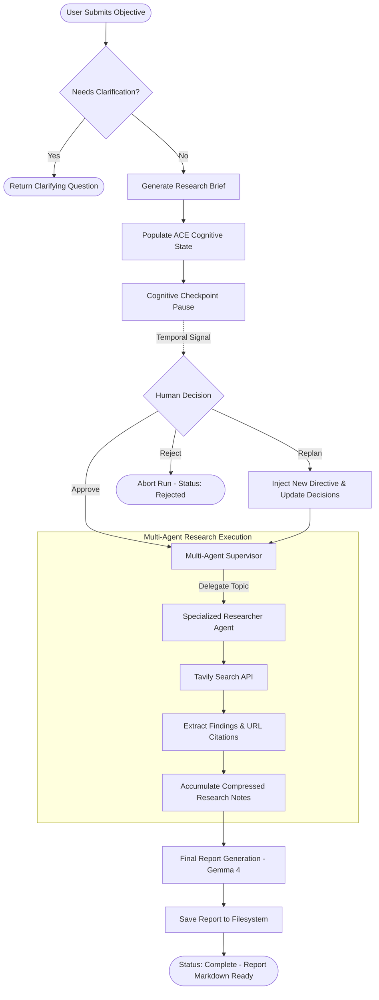
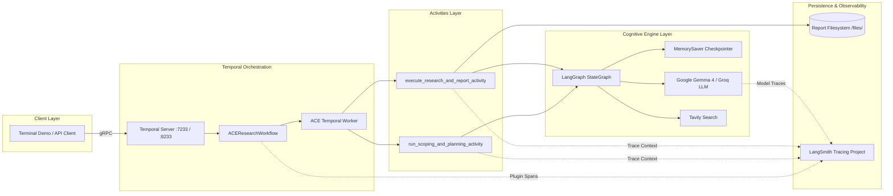

# Autonomous Cognitive Engine (ACE) for Deep Research and Long-Horizon Tasks

> **ACE is an open-source, stateful multi-agent research engine for complex, long-running research tasks. It combines planning, coordinated web research, human approval and replanning, explicit cognitive state, and Temporal-backed execution so users can inspect and steer research rather than treating it as an opaque one-shot LLM call.**

---

## 📌 Project Status & Implementation Caveats

- **Active Branch**: `temporal` (tested with Python 3.11, 3.12, and 3.13 via Astral `uv`).
- **Dual Execution Modes**:
  1. **Primary Production Execution (Recommended)**: Temporal Workflow + Failure-Isolated Activities ([`temporal_integration/workflows.py`](file:///Users/sukrutdusane/Documents/Projects%20/Sy/Autonomous-Cognitive-Engine-for-Deep-Research-and-Long-Horizon-Tasks/Autonomous-Cognitive-Engine-for-Deep-Research-and-Long-Horizon-Tasks/temporal_integration/workflows.py), [`temporal_integration/activities.py`](file:///Users/sukrutdusane/Documents/Projects%20/Sy/Autonomous-Cognitive-Engine-for-Deep-Research-and-Long-Horizon-Tasks/Autonomous-Cognitive-Engine-for-Deep-Research-and-Long-Horizon-Tasks/temporal_integration/activities.py)). Coordinates scoping, human checkpoint pause, multi-agent research, and report generation with bounded retries, timeouts, and zero-CPU idle wait states.
  2. **Experimental Adapter**: Node-level Temporal LangGraphPlugin adapter ([`temporal_integration/adapters.py`](file:///Users/sukrutdusane/Documents/Projects%20/Sy/Autonomous-Cognitive-Engine-for-Deep-Research-and-Long-Horizon-Tasks/Autonomous-Cognitive-Engine-for-Deep-Research-and-Long-Horizon-Tasks/temporal_integration/adapters.py)). Maps individual LangGraph nodes to Temporal execution metadata (`execute_in="activity"` vs `"workflow"`).
- **Honest Durability Guarantees**:
  - **LangGraph Checkpoint State**: Managed via `MemorySaver`. Operates within single Python worker processes for graph pauses and resumes. It does *not* survive process termination by itself unless backed by a persistent checkpointer.
  - **Temporal Workflow History**: Persisted on the Temporal Server. Survives worker crashes, worker restarts, and machine reboots. Workflows replay deterministically from their event log.
  - **Report Artifacts**: Persisted to local disk (`src/deep_research_from_scratch/files/report_<id>.md`) or mounted Docker volumes. Survives application and worker restarts.

---

## 🎯 What Are We Building?

Standard LLM assistants are optimized for immediate, single-turn answers. When assigned a multi-hour investigation—such as benchmarking distributed consensus algorithms, auditing regulatory compliance across jurisdictions, or analyzing long-term agent memory architectures—single-prompt agents fail. They suffer from context bloat, hallucinate missing citations, cannot recover when external APIs rate-limit them, and execute as opaque black boxes where the user has zero ability to steer intermediate findings.

**ACE changes this paradigm by turning deep research into an explicit, stateful, and steerable engineering process:**
1. **Intake & Scope**: Validates user intent and requests clarification before burning tokens.
2. **Cognitive Brief Generation**: Produces a structured research plan anchoring all subsequent investigation.
3. **Explicit Cognitive State**: Maintains living tracking of tasks, decisions, sources, and unresolved questions.
4. **Human Review Checkpoint**: Pauses execution so a human can inspect the plan, approve it, or inject a replanning directive.
5. **Hierarchical Multi-Agent Execution**: A supervisor agent delegates isolated sub-topics to specialized researcher agents equipped with web search.
6. **Report Synthesis & Artifact Persistence**: Consolidates findings into a publication-grade markdown report.
7. **Durable & Observable Runtime**: Wrapped in Temporal for crash recovery, activity retries, and sleep-state checkpoint pauses, with every model call and tool execution traced in LangSmith.

---

## 💡 The Problem Statement: Why Simple LLM Chat Fails

| Requirement | Simple LLM Chat / Script | Autonomous Cognitive Engine (ACE) |
|---|---|---|
| **Multi-Step Decomposition** | Tries to answer everything in one prompt. | Scopes objective, generates research brief, breaks down into targeted sub-tasks. |
| **Context Hygiene** | Stuffing 50 search results into one prompt causes "context rot" and hallucinations. | Hierarchical supervisor spawns isolated researcher sub-agents with clean context windows. |
| **Operational Durability** | If network drops or an API hits HTTP 429, the entire 45-minute run crashes and is lost. | Temporal activities automatically retry transient failures with exponential backoff; workflow history replays seamlessly. |
| **Steerability** | Black box: user waits 20 minutes and hopes the output matches expectations. | Explicit human checkpoint pause: user inspects the cognitive brief and can dynamically replan or cancel. |
| **Observability** | Console print statements or silent failures. | Linked LangSmith traces correlating tokens, tool latency, and model prompts with Temporal workflow IDs. |
| **Resource Efficiency** | While waiting for human input, long-running scripts keep threads or containers busy-polling. | Temporal `wait_condition` puts the workflow into a durable sleep state on the server with 0 CPU overhead. |

### Distinct Component Roles

To avoid architectural confusion, ACE strictly separates responsibilities:
- **LangGraph**: Governs the *cognitive graph*, agent state transitions, conditional routing, and node execution.
- **Temporal**: Governs the *operational durability*, scheduling, activity retries, timeouts, workflow history replay, and human-in-the-loop signals.
- **LangSmith**: Governs *observability, evaluation, and tracing*, exposing token usage, model latency, and prompt debugging.
- **LLMs & Tavily**: Provide *reasoning, extraction, and external evidence retrieval*.

---

## 👥 Core User Personas

### Persona 1: Research Analyst
- **Role**: Technology or Market Research Analyst investigating emerging domains.
- **Goals**: Produce structured, well-sourced technical dossiers comparing architectures, vendor capabilities, and industry trade-offs.
- **Pain Points**: Manual search takes days; single-shot AI agents output generic fluff with broken links and hallucinated claims.
- **How ACE Helps**: Scopes the investigation into an explicit brief, gathers real web evidence across isolated researcher agents, and outputs a structured report with source attribution.
- **Example Use Case**: *"Produce a competitive landscape report comparing enterprise vector database solutions (Pinecone, Qdrant, Milvus, Weaviate) across indexing latency, hybrid search, and multi-tenant security."*

### Persona 2: AI Engineer / Agent Developer
- **Role**: AI Systems Architect designing durable, production-grade agent workflows.
- **Goals**: Build reliable multi-agent systems that survive model rate limits, API timeouts, and machine restarts without losing progress.
- **Pain Points**: Debugging distributed agent loops is difficult; agent handoffs are opaque; transient API outages fail entire runs.
- **How ACE Helps**: Inspectable LangGraph transitions, explicit cognitive state schemas, Temporal activity retries with exponential backoff, and full LangSmith trace correlation.
- **Example Use Case**: *"Deploy a durable research agent inside our internal developer platform that lets engineers submit background research tasks and inspect progress via Temporal UI."*

### Persona 3: Graduate Student / Technical Learner
- **Role**: Graduate student or software engineer mastering an unfamiliar technical discipline.
- **Goals**: Quickly understand foundational principles, state-of-the-art developments, and open research questions.
- **Pain Points**: Generic LLM summaries lack technical depth; finding primary papers and authoritative documentation is tedious.
- **How ACE Helps**: Decomposes the topic into structured sub-questions, surfaces primary sources, and lets the learner redirect the research plan at the cognitive checkpoint.
- **Example Use Case**: *"Investigate speculative decoding algorithms in LLM inference. Compare draft-model verification against Medusa and lookahead approaches."*

### Persona 4: Technical Team Lead / Research Manager
- **Role**: Engineering Director or Research Manager overseeing automated research workflows.
- **Goals**: Ensure research quality, maintain human governance before expensive computations, and audit agent findings.
- **Pain Points**: Inability to intervene in long-running agent execution; difficulty auditing why an agent reached a specific conclusion.
- **How ACE Helps**: Mandatory human approval checkpoint allows the lead to inspect or revise the plan before sub-agents execute; full audit trail preserved in Temporal and LangSmith.
- **Example Use Case**: *"Review an automated security audit research plan for Kubernetes cluster configurations before approving heavy external searches."*

---

## 🔬 How ACE Works: A Real Research Example

Consider this complex, long-horizon research prompt:

> *"Investigate how persistent memory architectures affect the reliability of autonomous AI agents. Compare major approaches, evidence, limitations, and implementation trade-offs. Recommend an architecture for a research agent that must run for several hours."*

Here is how ACE processes this objective through its lifecycle:

```
User Prompt
    │
    ▼
[1. Objective Intake] ────────── Validates prompt non-empty; generates thread_id
    │
    ▼
[2. Scoping & Clarification] ─── Groq model determines if prompt is clear
    │                            (If vague → returns clarification question to user)
    ▼
[3. Research Brief & Plan] ──── Produces structured brief; initializes Cognitive State
    │
    ▼
[4. Human Review Checkpoint] ─── Temporal workflow pauses with 0 CPU overhead
    │                            User inspects cognitive plan snapshot in terminal/UI
    ├──────────────────────────► Decision: REPLAN → overrides plan & updates decisions
    ├──────────────────────────► Decision: REJECT → aborts workflow cleanly
    ▼ (APPROVE)
[5. Supervisor Coordination] ─── Lead agent breaks brief into targeted search topics
    │
    ▼
[6. Researcher Agents] ───────── Spawns researcher agents with Tavily web retrieval
    │                            (Extracts findings, filters URLs, isolates context)
    ▼
[7. Report Synthesis] ────────── Primary cognitive model synthesizes comprehensive report
    │
    ▼
[8. Artifact Persistence] ────── Saves report markdown file to disk (/files/report_<id>.md)
    │
    ▼
[9. Observability Inspection] ── Workflow history in Temporal (:8233), Traces in LangSmith
```

### Stage-by-Stage Breakdown

| Stage | Input | Action | Output | Failure / Durability Semantics |
|---|---|---|---|---|
| **1. Intake** | User research prompt | Parses input and registers Temporal Workflow ID | `ResearchWorkflowInput` | Empty string fails immediately with non-retryable error. |
| **2. Scoping** | Raw user request | Groq (`qwen/qwen3.8-27b`) evaluates scope | `ClarifyWithUser` decision | If clarification needed, workflow exits cleanly with `clarification_needed` status. |
| **3. Plan & State** | Conversation buffer | Generates `ResearchQuestion` brief and initializes cognitive fields | `AgentState` with `objective`, `research_plan`, `decisions` | Activity retry on model timeout. |
| **4. Checkpoint** | Cognitive state snapshot | Executes LangGraph `interrupt()`; workflow waits for Temporal Signal | Paused state; zero CPU load | Workflow remains durably sleeping on Temporal Server across machine restarts. |
| **5. Supervisor** | Approved research brief | Formulates search strategy using `ConductResearch` tools | Targeted sub-queries | Rate-limit retries on model quota exhaustion. |
| **6. Research** | Sub-topic query | Researcher agents query Tavily, summarize web content | Compressed findings & raw notes | Concurrency bounded (`max_concurrent_researchers=1`) to avoid rate limits. |
| **7. Synthesis** | All research notes | Google Gemma 4 synthesizes comprehensive report | Formatted report text | Bounded retries if model provider suffers transient 500 error. |
| **8. Artifact** | Report text | Asynchronously writes markdown file to filesystem | File path `report_<id>.md` | Idempotent file write on activity retry. |
| **9. Observability** | Execution trace | Temporal & LangSmith plugins correlate runs | Live UI links | Tracing failure never crashes the underlying research workflow. |

---

## 🏛️ Architecture Overview

### Diagram A: Logical ACE Research Flow



### Diagram B: Integration Architecture



---

## 🧠 Why ACE? How It Relates to LangChain Deep Agents

[LangChain Deep Agents](https://www.langchain.com/deep-agents) (`langchain-ai/deepagents`) is an open-source, batteries-included agent harness designed for general-purpose long-horizon tasks (coding, agent sandboxes, and virtual file operations). It is built on top of LangGraph.

Because ACE and Deep Agents share overlapping goals, this section establishes an honest, rigorous architectural comparison:

### Feature Comparison Matrix

| Capability | Existing ACE Engine | LangChain Deep Agents | Architectural Relationship |
|---|---|---|---|
| **Primary Focus** | Deep research, scoping, citation-backed report synthesis. | General-purpose harness for long-horizon agent execution (coding, sandbox tasks). | ACE provides research-specific pedagogy; Deep Agents provides a generic agent container. |
| **Planning & Task Tracking** | Explicit cognitive state (`tasks`, `decisions`, `unresolved_questions`). | Task-planning middleware (structured TODO tracks). | ACE state is research-oriented; Deep Agents is generalized task tracking. |
| **Multi-Agent Coordination** | Hierarchical supervisor with isolated researcher context windows. | Built-in sub-agent delegation with isolated state. | Both isolate context to prevent context rot. |
| **Context Management** | Iterative summarization of web findings (`compressed_research`). | Built-in thread summarization and context offloading. | Compatible approaches to context hygiene. |
| **Virtual Filesystem** | Dedicated report artifact storage (`/files/`). | Pluggable virtual filesystem (local, docker, remote) for tool outputs. | Deep Agents can offload intermediate data; ACE focuses on the final dossier. |
| **Human Governance** | Structured cognitive checkpoint pause via LangGraph `interrupt()` + Temporal Signals. | Native human-in-the-loop tool-call approval hooks. | Both enable user steering; ACE pauses after planning, before expensive research. |
| **Durable Execution** | Full Temporal workflow and activity coordination with event-log replay. | Native LangGraph checkpoint persistence. | Temporal provides multi-day workflow survivability, sleep states, and activity retries. |
| **Observability** | Dual-layer: Temporal UI (workflow history) + LangSmith (model/tool spans). | LangSmith-native agent tracing. | Temporal LangSmith plugin links workflow operations directly into LangSmith runs. |
| **Evidence & Sources** | Explicit `sources` and `notes` state fields; Tavily search integration. | General tool integration; tools configured by developer. | ACE has dedicated web research and citation accumulators. |
| **Report Generation** | Integrated multi-section report writer prompt with Gemma 4. | General model generation capabilities. | ACE includes specialized synthesis prompts. |

### Integration Strategy Evaluation

1. **Option A — Keep ACE as Custom Research Engine (Current Implementation - Chosen)**:
   - *Rationale*: ACE’s research-specific scoping, cognitive state, human approval checkpoint, and Temporal durability already solve deep research cleanly. Preserving this architecture avoids adding unnecessary framework dependencies while maintaining maximum hackathon demonstration stability.
2. **Option B — Deep Agents as Specialized Research Workers (Future Roadmap)**:
   - *Rationale*: ACE acts as the top-level Research Director (scoping, human approval, global state, report synthesis), while a Deep Agent instance is invoked as a specialized research worker for complex, multi-step sub-investigations requiring virtual filesystem access or sub-agent delegation.
3. **Option C — Complete Migration to Deep Agents (Rejected)**:
   - *Rationale*: Replacing ACE’s research pipeline with Deep Agents would strip out the proven scoping, clarification, and checkpointing logic without improving research output quality.

---

## 📊 Cognitive State Model

ACE represents an agent’s internal mental model through explicit fields on `AgentState`:

| Field | Type | Reducer | Description |
|---|---|---|---|
| `objective` | `str` | Overwrite | Original user research intent preserved verbatim across multi-turn reasoning. |
| `research_plan` | `str` | Overwrite | Living research brief and investigation outline produced during scoping. |
| `tasks` | `list[str]` | `operator.add` | All sub-topics and research tasks identified by the supervisor. |
| `completed_tasks` | `list[str]` | `operator.add` | Sub-tasks whose investigation has finished. |
| `pending_tasks` | `list[str]` | `operator.add` | Sub-tasks scheduled or currently in progress. |
| `sources` | `list[str]` | `operator.add` | Discovered URLs and verified primary reference materials. |
| `decisions` | `list[str]` | `operator.add` | Key architectural, analytical, and replanning decisions made by agent or human. |
| `unresolved_questions`| `list[str]` | `operator.add` | Open questions identified during research that require further inquiry. |
| `status` | `str` | Overwrite | Lifecycle state: `pending`, `scoping`, `planning`, `paused`, `researching`, `complete`, `rejected`. |
| `final_report` | `str` | Overwrite | Formatted markdown research dossier. |

---

## 🛡️ Reliability, Retries, and Durability Guarantees

### The Three-Tier Durability Model

```
┌─────────────────────────────────────────────────────────────┐
│ 1. LangGraph State Checkpoint (MemorySaver)                 │
│    • Scope: Process memory inside Python worker.            │
│    • Recovers: Graph pause & resume across node interrupts. │
│    • Does NOT survive: Worker process termination.          │
└──────────────────────────────┬──────────────────────────────┘
                               │
┌──────────────────────────────▼──────────────────────────────┐
│ 2. Temporal Workflow History (Server Event Log)              │
│    • Scope: Persisted on Temporal Server / Cluster database.│
│    • Recovers: Worker restarts, machine crashes, timeouts.  │
│    • Replays: State, activities, and signal decisions.      │
└──────────────────────────────┬──────────────────────────────┘
                               │
┌──────────────────────────────▼──────────────────────────────┐
│ 3. Report Artifact Storage (Local Disk / Named Volume)       │
│    • Scope: Persistent filesystem (/files/report_<id>.md).  │
│    • Recovers: Final outputs survive complete environment   │
│      shutdowns and rebuilds.                                │
└─────────────────────────────────────────────────────────────┘
```

### Activity Retries and Error Handling

Temporal activities in ACE are configured with explicit, bounded retry policies:
- **Scoping Activity Timeout**: 10 minutes.
- **Research Activity Timeout**: 30 minutes.
- **Retry Policy**:
  - `initial_interval`: 2 seconds
  - `backoff_coefficient`: 2.0 (exponential backoff: 2s, 4s, 8s...)
  - `maximum_attempts`: 3
  - `non_retryable_error_types`: `["ApplicationError", "ValueError"]` (Validation errors fail immediately rather than looping).
- **Concurrency & Rate Limits**: In `multi_agent_supervisor.py`, `max_concurrent_researchers = 1` prevents exhausting provider rate limits (e.g., Groq’s 6,000 TPM limit).

---

## 👁️ Observability: Temporal UI & LangSmith

### Temporal Web UI (`http://localhost:8233`)
1. Open the UI to view active workflows under namespace `default`.
2. Inspect `ACEResearchWorkflow` runs:
   - Review the complete event history (`WorkflowTaskScheduled`, `ActivityTaskStarted`, `ActivityTaskCompleted`).
   - Observe the workflow sleeping in the `paused` state during human approval.
   - Inspect the `submit_approval` signal payload containing approval or replan directives.

### LangSmith Dashboard (`https://smith.langchain.com`)
1. Navigate to your project (default: `ace-temporal-demo`).
2. The official `LangSmithPlugin(project_name=..., add_temporal_runs=True)` automatically correlates:
   - Outer Temporal workflow runs.
   - Temporal activity spans.
   - LangGraph node executions.
   - Model prompt inputs, output completions, token counts, and latency.

---

## 📦 Prerequisites & Installation

### System Requirements
- **Python**: `3.11`, `3.12`, or `3.13`
- **Package Manager**: [uv](https://docs.astral.sh/uv/)
- **Temporal CLI**: [Temporal CLI Installation](https://docs.temporal.io/cli)

### 1. Clone Repository & Checkout the `temporal` Branch

```bash
git clone -b temporal https://github.com/rohan-kapadi/Autonomous-Cognitive-Engine-for-Deep-Research-and-Long-Horizon-Tasks.git
cd Autonomous-Cognitive-Engine-for-Deep-Research-and-Long-Horizon-Tasks
```

### 2. Install Locked Dependencies

```bash
uv sync --extra dev
```

### 3. Configure Environment Variables

```bash
cp .env.example .env
```

Ensure the following variables are configured in `.env`:

```env
# Required for Model Reasoning & Web Search
GOOGLE_API_KEY=your_google_gemini_api_key
GROQ_API_KEY=your_groq_api_key
TAVILY_API_KEY=your_tavily_search_api_key

# LangSmith Tracing & Observability
LANGCHAIN_TRACING_V2=true
LANGSMITH_API_KEY=your_langsmith_api_key
LANGSMITH_PROJECT=ace-temporal-demo

# Temporal Durable Execution
TEMPORAL_ADDRESS=localhost:7233
TEMPORAL_NAMESPACE=default
TEMPORAL_TASK_QUEUE=ace-research
TEMPORAL_WORKFLOW_ID_PREFIX=ace-research
```

---

## 🚀 Running the Demonstrations

### Path 1: Temporal Durable Demo (Judge-Ready Interactive CLI)

1. **Start Temporal Dev Server** (Terminal 1):
   ```bash
   temporal server start-dev
   ```
   *UI opens at [http://localhost:8233](http://localhost:8233).*

2. **Start the ACE Worker** (Terminal 2):
   ```bash
   uv run python -m temporal_integration.worker
   ```

3. **Run the Interactive Demo** (Terminal 3):
   ```bash
   uv run python demo_ace_temporal.py
   ```
   - Enter your research topic or press `ENTER` for the default topic.
   - Watch Temporal schedule scoping and pause at the cognitive checkpoint.
   - View the snapshot in your terminal, and inspect the run in Temporal UI and LangSmith.
   - Press `ENTER` to approve the plan, or type a replan directive (e.g., *"Focus specifically on open-source vector engines"*).
   - Review the completed report preview and output path.

### Path 2: Standalone LangGraph Execution (No Temporal Required)

```bash
uv run python demo_ace_run.py
```

### Path 3: Live LangSmith Tracing Demo

```bash
uv run python demo_ace_langsmith.py
```

### Path 4: LangGraph Studio UI

```bash
uvx --refresh --from "langgraph-cli[inmem]" --with-editable . --python 3.12 langgraph dev --allow-blocking
```
*Open Studio at: `https://smith.langchain.com/studio/?baseUrl=http://localhost:8000`*

---

## 🐳 Docker Deployment

The repository includes a complete multi-container setup running the Temporal server, ACE worker, and LangGraph dev server:

```bash
# Build and run the entire stack
docker compose up -d

# Check running services
docker compose ps

# Tail worker logs
docker compose logs -f temporal-worker
```

Services exposed:
- **Temporal Web UI**: `http://localhost:8233`
- **Temporal gRPC**: `localhost:7233`
- **LangGraph API**: `http://localhost:8000`

---

## 🧪 Testing & Verification

The test suite runs 100% offline with zero external API dependencies (all external LLM, Tavily, and Temporal server calls are mocked or execute in an in-memory test environment):

```bash
# Run all tests
uv run pytest tests/
```

### Test Suite Breakdown

| Test File | Tests | What It Proves |
|---|---|---|
| [`tests/test_existing_behavior.py`](file:///Users/sukrutdusane/Documents/Projects%20/Sy/Autonomous-Cognitive-Engine-for-Deep-Research-and-Long-Horizon-Tasks/Autonomous-Cognitive-Engine-for-Deep-Research-and-Long-Horizon-Tasks/tests/test_existing_behavior.py) | 5 passed | Core LangGraph nodes, transitions, cognitive state initializers, and plugin adapters remain intact. |
| [`tests/test_temporal_workflow.py`](file:///Users/sukrutdusane/Documents/Projects%20/Sy/Autonomous-Cognitive-Engine-for-Deep-Research-and-Long-Horizon-Tasks/Autonomous-Cognitive-Engine-for-Deep-Research-and-Long-Horizon-Tasks/tests/test_temporal_workflow.py) | 4 passed | Workflow lifecycle, empty objective validation, activity retry policy with backoff, and scoping clarification handling. |
| [`tests/test_human_resume.py`](file:///Users/sukrutdusane/Documents/Projects%20/Sy/Autonomous-Cognitive-Engine-for-Deep-Research-and-Long-Horizon-Tasks/Autonomous-Cognitive-Engine-for-Deep-Research-and-Long-Horizon-Tasks/tests/test_human_resume.py) | 3 passed | Human approval signal, dynamic replan directive propagation, and plan rejection handling. |
| [`tests/test_langsmith_integration.py`](file:///Users/sukrutdusane/Documents/Projects%20/Sy/Autonomous-Cognitive-Engine-for-Deep-Research-and-Long-Horizon-Tasks/Autonomous-Cognitive-Engine-for-Deep-Research-and-Long-Horizon-Tasks/tests/test_langsmith_integration.py) | 3 passed | LangSmith plugin configuration, consistent project naming, and workflow execution with plugin attached. |

---

## 📁 Repository Structure

```
Autonomous-Cognitive-Engine-for-Deep-Research-and-Long-Horizon-Tasks/
├── .env.example                      # Template for all environment variables
├── pyproject.toml                    # Dependencies (temporalio, langgraph, langchain)
├── uv.lock                           # Locked dependency graph
├── Dockerfile                        # Multi-stage container image
├── docker-compose.yml                # Temporal Server, Worker, and App configuration
├── langgraph.json                    # Registered LangGraph graph endpoints
├── setup.md                          # Quick setup reference guide
├── README.md                         # Canonical system documentation
│
├── demo_ace_temporal.py              # Interactive Temporal + LangSmith demonstration
├── demo_ace_langsmith.py             # LangSmith live tracing demonstration
├── demo_ace_run.py                   # Standalone LangGraph demonstration
├── test_ace_checkpoint.py            # Graph checkpoint & interrupt verification
│
├── temporal_integration/             # Temporal durable execution package
│   ├── __init__.py                   # Package exports
│   ├── config.py                     # TemporalConfig and LangSmithPlugin factory
│   ├── schemas.py                    # Serializable dataclass data contracts
│   ├── activities.py                 # Scoping, research, and report activities
│   ├── workflows.py                  # ACEResearchWorkflow with signals and queries
│   ├── client.py                     # ACEWorkflowClient high-level API
│   ├── worker.py                     # Standalone worker runner
│   └── adapters.py                   # Node-level Temporal LangGraphPlugin adapter
│
├── src/deep_research_from_scratch/   # Core ACE research agent modules
│   ├── research_agent_full.py        # Production graph with cognitive checkpoint
│   ├── research_agent_scope.py       # Scoping and brief generation nodes
│   ├── multi_agent_supervisor.py     # Supervisor agent and parallel tool caller
│   ├── research_agent.py             # Tavily search researcher agent
│   ├── state_scope.py                # AgentState schema and cognitive field definitions
│   ├── generate_checkpoint.py        # Checkpointer factory & state snapshot utilities
│   ├── gemma_model.py                # Cognitive model factory (Gemma 4 / Groq)
│   ├── prompts.py                    # Lead researcher, scoping, and report prompts
│   ├── utils.py                      # Search functions and thinking tools
│   └── files/                        # Output directory for generated research reports
│
└── tests/                            # Automated test suite
    ├── conftest.py                   # Mock test environment fixtures
    ├── test_existing_behavior.py     # Regression tests for original graph
    ├── test_temporal_workflow.py     # Temporal workflow execution and retries
    ├── test_human_resume.py          # Human approval, replan, and rejection
    └── test_langsmith_integration.py # LangSmith plugin verification
```

---

## ⚙️ Configuration Reference

| Variable | Default Value | Description |
|---|---|---|
| `GOOGLE_API_KEY` | *(None)* | Google AI Studio key for primary Gemma 4 cognitive model. |
| `GROQ_API_KEY` | *(None)* | Groq API key for high-speed scoping and clarification structured output. |
| `TAVILY_API_KEY` | *(None)* | Tavily Search API key for researcher web queries. |
| `LANGCHAIN_TRACING_V2` | `true` | Enables LangChain / LangSmith v2 tracing. |
| `LANGSMITH_API_KEY` | *(None)* | LangSmith API key for exporting traces. |
| `LANGSMITH_PROJECT` | `ace-temporal-demo`| LangSmith project destination. |
| `TEMPORAL_ADDRESS` | `localhost:7233` | Host and port of the Temporal gRPC service. |
| `TEMPORAL_NAMESPACE` | `default` | Temporal execution namespace. |
| `TEMPORAL_TASK_QUEUE` | `ace-research` | Task queue polled by ACE workers. |
| `TEMPORAL_WORKFLOW_ID_PREFIX` | `ace-research` | Prefix used when auto-generating workflow IDs. |
| `RESEARCH_MODEL_PROVIDER` | `google` | Primary cognitive model provider (`google` or `groq`). |
| `GROQ_MODEL` | `groq:qwen/qwen3.8-27b` | Model used for scoping when Groq is configured. |

---

## ❓ Troubleshooting

| Issue | Root Cause | Solution |
|---|---|---|
| `Connection refused: localhost:7233` | Local Temporal server is not running. | Run `temporal server start-dev` in a separate terminal. |
| `groq.GroqError: The api_key client option must be set` | Missing `GROQ_API_KEY` in environment. | Ensure `.env` is populated with `GROQ_API_KEY` and run `dotenv.load_dotenv()`. |
| `LangSmithMissingAPIKeyWarning` | Tracing enabled but no `LANGSMITH_API_KEY`. | Traces are skipped gracefully; provide a key in `.env` to record runs in LangSmith. |
| `Interrupts are only supported when a checkpointer is enabled` | Graph was compiled without checkpointer. | In [`research_agent_full.py`](file:///Users/sukrutdusane/Documents/Projects%20/Sy/Autonomous-Cognitive-Engine-for-Deep-Research-and-Long-Horizon-Tasks/Autonomous-Cognitive-Engine-for-Deep-Research-and-Long-Horizon-Tasks/src/deep_research_from_scratch/research_agent_full.py), ensure `agent = deep_researcher_builder.compile(checkpointer=ace_checkpointer)`. |
| Rate limit error (HTTP 429) during research | Exceeded provider TPM/RPM quota. | `multi_agent_supervisor.py` includes exponential backoff sleep; adjust `max_concurrent_researchers = 1`. |

---

## 🔮 Known Limitations & Roadmap

- **Durability Granularity**: The primary execution path executes scoping and research as failure-isolated Temporal activities. Activity retries recover from network and model hiccups. However, if a worker process crashes mid-research, the research activity retries from the beginning of that activity rather than resuming an internal LLM call midway. Full node-level execution is supported experimentally via `adapters.py`.
- **In-Memory Checkpointer Scope**: The graph currently uses `MemorySaver`. While cognitive state snapshots are preserved durably inside Temporal workflow history and queryable at any time, graph rehydration across worker processes relies on Temporal's input payload. Integrating a persistent checkpointer backend (such as SQLite or PostgreSQL) is planned for production deployments.
- **Supervisor Concurrency**: To stay within free/starter tier LLM rate limits, concurrency is intentionally throttled. Multi-node distributed researchers can be configured by increasing `max_concurrent_researchers`.

---

## 📜 Contributing & License

Contributions are welcome! Please open an issue or pull request on branch `temporal`.

This project is licensed under the MIT License.
